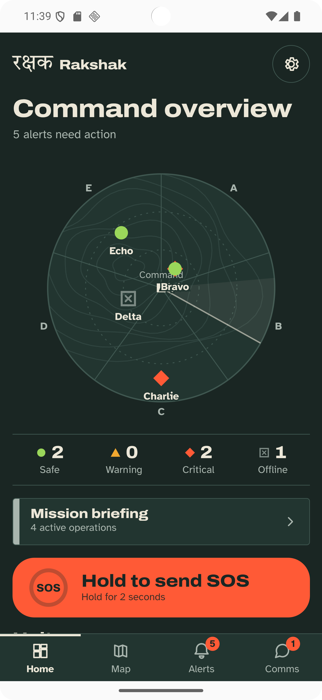
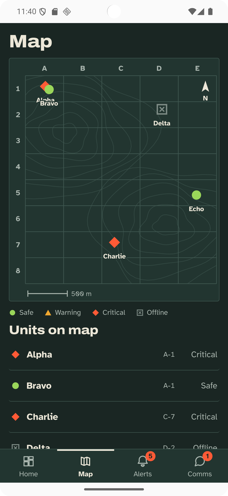
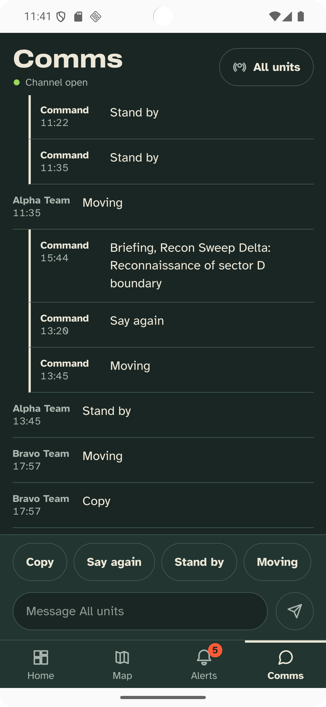
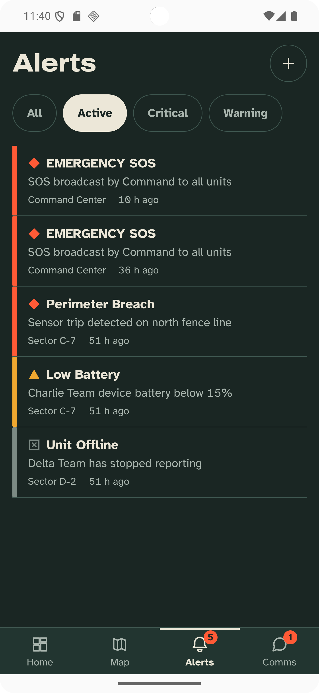
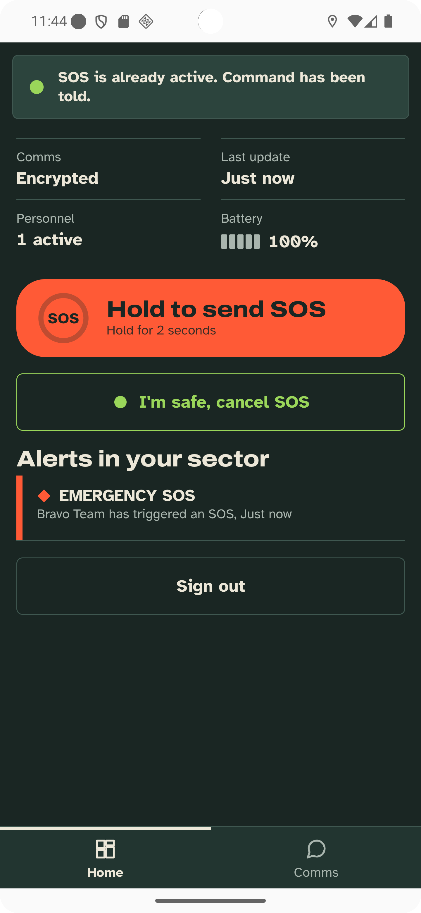
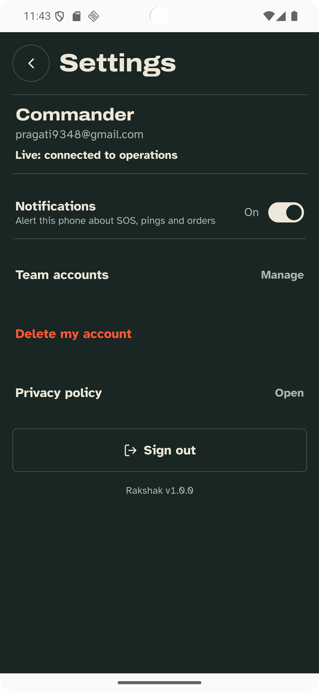

# Rakshak (रक्षक)

**Tactical command platform for Android.** A commander sees every field team on one live map, receives SOS alerts the moment they happen, and sends orders that field units accept or reject from their phones.

Built with React, Capacitor and Firebase. Runs as a native Android app (`com.pragati.rakshak`).

```html
<!-- Add screenshots in docs/screenshots -->
<p align="center">
  
  
  
</p>

<p align="center">
  
  
  
</p>

<p align="center">
  
  
  
</p>
```


## What it does

**Commander**
- Live dashboard of all teams: status, sector, battery, last update, roster
- Map of team positions, built from real phone GPS
- Alerts feed with acknowledge and resolve; manual alerts
- Ping a unit and get a reply, force a sync, or redeploy a team to a new sector (the field unit accepts or rejects)
- Missions: create, track progress, send a briefing to all units
- Team chat
- Create team accounts and set each member's name and role

**Field unit**
- Hold-to-send SOS (2 second hold, no accidental alerts) and "I'm safe, cancel SOS"
- Real battery level and GPS reported to command, including in the background
- Receives orders and answers pings automatically

## Tech stack

| Area | Choice |
|---|---|
| UI | React 19, Vite |
| Native shell | Capacitor 8 (Android) |
| Backend | Firebase Auth, Cloud Firestore (real-time sync) |
| Device | Capacitor Geolocation + background location (foreground service), Device, Local Notifications |
| Monitoring | Firebase Crashlytics |
| Optional | FCM push through a Cloud Function (`functions/`, off by default) |

## How it works

- **Roles.** Every user has a `users/{uid}` document with `role` (`commander` or `field`) and `unitId`. Commanders create accounts; there is no public sign-up.
- **Data.** `units`, `mapUnits`, `alerts`, `messages`, `missions`, `orders`, `roster`, `config` in Firestore. The app subscribes in real time.
- **Security.** All access is enforced by [`firestore.rules`](firestore.rules). A field unit can only update its own unit, resolve alerts, answer orders addressed to it, and post messages. Commanders manage everything. The Firebase web config in `src/firebase.js` is a public identifier, not a secret; the rules are what protect the data.
- **Demo mode.** `npm run dev` runs the app on in-memory sample data with a simulation, so it can be tried without a Firebase project. Release builds have demo mode removed.
- **Housekeeping.** Alerts and chat older than 7 days are hidden and deleted. Orders older than 1 day are cleaned up.

## Project structure

```
src/
  App.jsx          app shell, navigation, subscriptions, handlers
  api.js           the one data layer (demo and Firestore modes)
  components.jsx   shared UI: auth, map, unit detail, alerts, settings
  screens.jsx      comms, missions, field screen, location disclosure
  theme.jsx        design tokens, icons, sample data (demo only)
  tracker.js       GPS and battery reporting
  notify.js        local notifications
  push.js          FCM registration (optional)
  monitor.js       Crashlytics wrapper
  flags.js         build-time switches
  firebase.js      Firebase initialisation
functions/         Cloud Function for push (optional)
android/           Capacitor Android project
firestore.rules    database security rules
docs/              release guide and screenshots
```

## Run it

```bash
npm install
npm run dev          # demo mode, no Firebase needed
```

To run against your own Firebase project:

1. Create a Firebase project with **Authentication (email/password)** and **Firestore**.
2. Put your web config in `src/firebase.js`.
3. Deploy the rules: `firebase deploy --only firestore:rules`.
4. In Authentication, add your first user. In Firestore, create `users/<that uid>` with `role: "commander"`, `unitId: 1` (number), `email`.
5. Sign in, then create field accounts from **Settings, Team accounts**.

## Build the Android app

```bash
npm run build
npx cap sync
npx cap open android      # then Run in Android Studio
```

Add your own `google-services.json` to `android/app/` for Crashlytics. The step-by-step release guide (signing, Play Console, data safety) is in [`docs/PLAYSTORE.md`](docs/PLAYSTORE.md).

## Privacy

Location is collected only after an in-app disclosure and consent, only for signed-in field units, and only to show their position to their commander. Users can delete their account from inside the app. See the [privacy policy](https://pragati975.github.io/rakshak/privacy-policy.html).

## Author

**Pragati Rani Gouda**, B.Tech CSE, PMEC Brahmapur.
[LinkedIn](https://linkedin.com/in/pragati-rani-gouda-8515aa326) · [GitHub](https://github.com/Pragati975)
